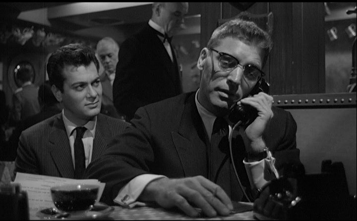

# Introduction

Hollywood operates on educated guesses. Studios bet hundreds of millions on films hoping audiences will show up, but nobody really knows which movies will succeed until they're already in theaters. Executives rely on star power, looking at what worked last year, and gut instinct. But can data actually do better than that?

This project analyzed 2,691 films from The Movie Database to answer a specific question: can we predict whether a movie will be profitable using only information available before release? Not after trailers drop and social media starts buzzing, but back when the film is still in development and investment decisions need to be made. The features examined include production budget, cast popularity, genre, release timing, and runtime. All factors known months before opening weekend.

Machine learning classification models were trained to predict profitability, with Random Forest performing best at 77.7% accuracy. That means roughly 8 out of 10 times, the model correctly identified whether a film would make money. Beyond just prediction, the work reveals patterns about what actually drives box office success and whether different types of movies follow completely different playbooks. Turns out the answers challenge some conventional wisdom about how Hollywood works.

{width=100%}

# Key Findings

The exploratory data analysis revealed several patterns that matter for understanding box office success. Cast popularity and production budget emerged as co-dominant predictors, each contributing 25% of the model's power. Not budget first with cast as a distant second. They tie. This quantifies what industry veterans know intuitively but challenges how studios actually allocate resources. The data says spending $150M on production while settling for cheaper talent is leaving money on the table.

High-budget films achieve near-optimal returns with lower risk. Films in the $80-150M range showed a median ROI of 2.9x, nearly matching Blockbusters at 3.1x while requiring half the capital investment. Budget and revenue correlate at 0.711, so spending more generally earns more, but the relationship isn't linear. The $80-150M tier represents a strategic sweet spot: high enough to fund compelling production values, low enough to avoid the risk concentration of $150M+ tentpoles. Medium-budget films in the $20-80M range underperform at 2.3x ROI despite their popularity, suggesting this tier lacks the scale advantages of larger productions without gaining the efficiency benefits of smaller ones.

Release timing creates measurable advantages that studios can actually control. Holiday and Summer releases outperform Fall releases, with effects varying by genre. The data quantifies real advantages from strategic timing. Family films thrive during holidays, horror films peak in October, dramas compete better during awards season in fall, and action films dominate summer releases. This isn't just tradition or superstition but measurable patterns in audience behavior.

The unsupervised learning phase revealed four natural movie archetypes with completely different risk-return profiles:

- **Blockbusters** (13% of films): Require massive capital but deliver 97% success rates and 5.5x ROI
- **Mid-Budget Hits** (35% of films): Balance risk and reward with 85% success and 4.2x ROI
- **Standard Indies** (49% of films): Serve as volume plays with 61% success and 2.4x ROI
- **Breakout Indies** (3% of films): Ultra-low-budget projects with 100% success and 39x ROI

This clustering matters because it shows different types of movies need fundamentally different strategies. A $150M tentpole faces different challenges than a $5M indie. Treating all films the same ignores real structural differences.

The supervised learning phase confirmed that prediction works but has limits. Random Forest achieved 77.7% accuracy, outperforming Logistic Regression at 75.3% and Gradient Boosting at 77.6%. More importantly, the model showed 96.3% recall, meaning it rarely misses profitable movies. For studios trying to avoid passing on the next *Get Out*, that high recall matters more than perfect overall accuracy. The 77.7% performance matches published academic research, which consistently achieves 75-82% regardless of method sophistication, suggesting a realistic ceiling for prediction given how many unpredictable factors influence movie success.

Genre analysis revealed substantial variation in success rates. Family films lead at 89% success, followed by Adventure at 85% and Fantasy at 84%. Animation and Action films both achieve roughly 80% success rates. At the lower end, Drama films succeed 71% of the time, while Thriller films face the toughest odds at 55% success.

This reflects audience appeal breadth rather than quality differences. Family content attracts multiple demographics and generates repeat viewings, while thrillers compete for narrower audiences. Genre also interacts with other factors in complex ways. Budget matters more for spectacle genres needing visual effects. Cast matters more for dramas and comedies relying on performance. Release timing effects vary by genre. No universal rules exist. Success factors depend on what type of film you're making.

These findings highlight that box office success depends on interactions between multiple factors rather than any single variable. The patterns are strong enough to enable meaningful prediction but not deterministic. The 77.7% accuracy ceiling reflects irreducible uncertainty in creative industries where quality, cultural timing, and unpredictable word-of-mouth dynamics play crucial roles nobody can fully control.

# Limitations

This project faced several limitations inherent to the data and methodology. The model predicts binary profitability rather than specific revenue amounts, so studios learn whether a film will likely make money but not whether it will earn $50M or $500M. Marketing quality represents a significant unmeasured variable. The analysis uses budget as a proxy for marketing spend but cannot account for campaign execution, where a brilliant campaign can save a mediocre film or a terrible campaign can sink a good one.

Cultural phenomena remain fundamentally unpredictable. No algorithm would have predicted "Barbenheimer" where *Barbie* and *Oppenheimer* drove each other's success through organic social media synergy. These lightning-in-a-bottle moments reshape industries precisely because they're unprecedented and can't appear in historical patterns.

The temporal coverage poses challenges for applying findings to today's market. Most data comes from before streaming competition intensified to current levels. Theatrical windows have shrunk from months to weeks, and audience behavior continues shifting toward selectivity about what justifies theater visits versus waiting for streaming. That said, the consistency of core predictors like cast and budget across time periods suggests fundamental patterns remain stable even as the industry evolves.

{width=100%}

Finally, the 77.7% accuracy ceiling suggests inherent unpredictability in creative industries. Movies involve too many variables: creative quality, cultural timing, competitive landscape, marketing execution, word-of-mouth dynamics. Even with perfect data and optimal algorithms, some irreducible uncertainty remains. The convergence of multiple academic studies achieving similar accuracy regardless of method sophistication suggests this represents a realistic limit rather than a methodological failure.

# Future Research

Several directions could extend this work beyond its current scope. Incorporating social media sentiment analysis during marketing campaigns would capture buzz momentum that pre-production data misses. Research by Kim et al. achieved 82% accuracy by adding Twitter and review site sentiment to traditional features. Adding competitive landscape analysis would account for what else releases the same weekend, since a good movie facing *Avengers* has different prospects than one with a clear field.

Including filmmaker track records as quantifiable features could improve predictions. Some directors and producers consistently deliver: Christopher Nolan, James Cameron, Jordan Peele. Their involvement changes risk profiles in ways executives recognize but the model currently ignores. Building genre-specific models might increase accuracy by capturing nuances a universal model misses, since horror and family films follow different rules.

Expanding to revenue regression rather than binary classification would provide more actionable guidance. Instead of "probably profitable," studios want "probably $150-200M domestic." This requires different modeling approaches, additional features like screen count and international data, and handling the long tail of revenue distributions.

These extensions would likely require access to proprietary industry data on marketing spends, theater bookings, and competitive positioning that aren't publicly available. Partnerships with studios or distributors could enable research bridging the gap between academic models and industry practice.

# Conclusion

This project demonstrates that box office success is predictable to a meaningful degree using machine learning, but not perfectly so. The 77.7% accuracy achieved matches academic benchmarks and likely represents a realistic ceiling given the inherent unpredictability of creative industries. The analysis confirms that cast popularity and budget matter equally, mid-budget films offer optimal risk-adjusted returns, and strategic release timing creates measurable advantages.

The identification of four distinct movie archetypes provides practical insight beyond simple prediction. Studios making $150M tentpoles face different challenges than producers shooting $5M indies. Recognizing these differences enables tailored strategies rather than universal rules that fit nobody well. The high recall at 96.3% means the model rarely misses profitable opportunities, which matters more for practical decision-making than perfect overall accuracy.

While data-driven approaches improve investment decisions at the margins, they won't replace creative judgment. Cultural phenomena like "Barbenheimer" remain unpredictable by definition. The real value lies in combining algorithmic pattern recognition with human intuition. When executives evaluate projects, prediction models can reality-check whether gut feelings align with historical patterns or represent wishful thinking.

The post-pandemic landscape has introduced new complexities: streaming competition, shrinking theatrical windows, shifting audience behavior. Yet the fundamental predictors remain consistent across time periods. What changes isn't whether cast and budget matter but the baseline success rate. Fewer movies succeed overall in the new normal, but the factors determining which ones do stay stable. This suggests the patterns identified here will remain relevant even as the industry continues evolving.

Future research incorporating social media sentiment, competitive landscape, and filmmaker track records could push accuracy higher. But even at current levels, these models provide actionable intelligence for an industry that has traditionally relied on instinct. The studios that combine creative vision with data-driven decision-making will consistently outperform those depending on either alone. That's not speculation. It's what the data shows.